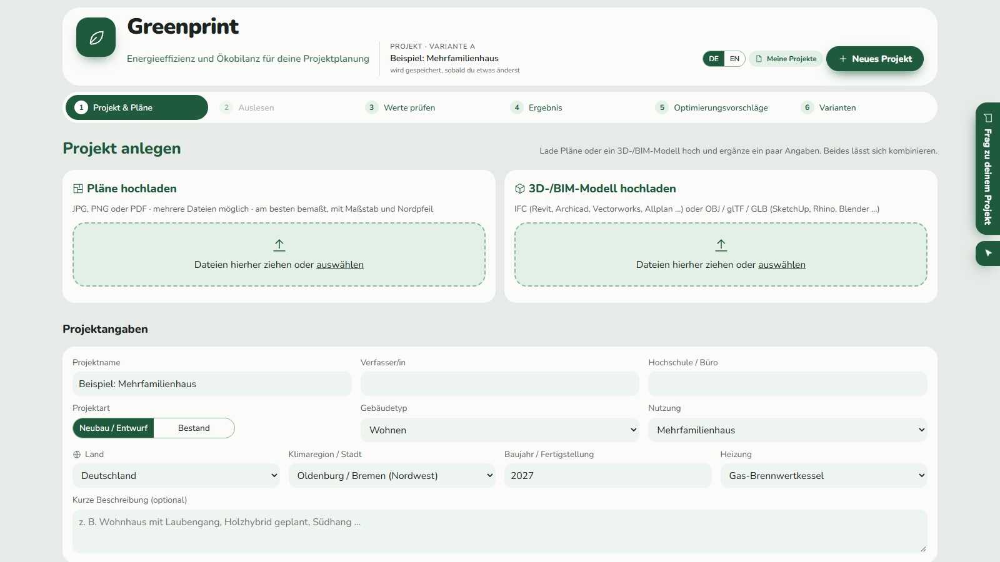
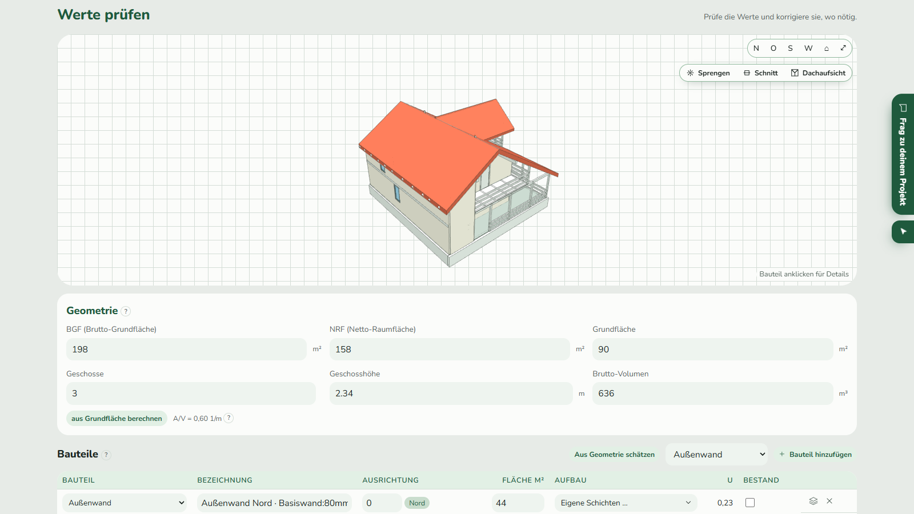
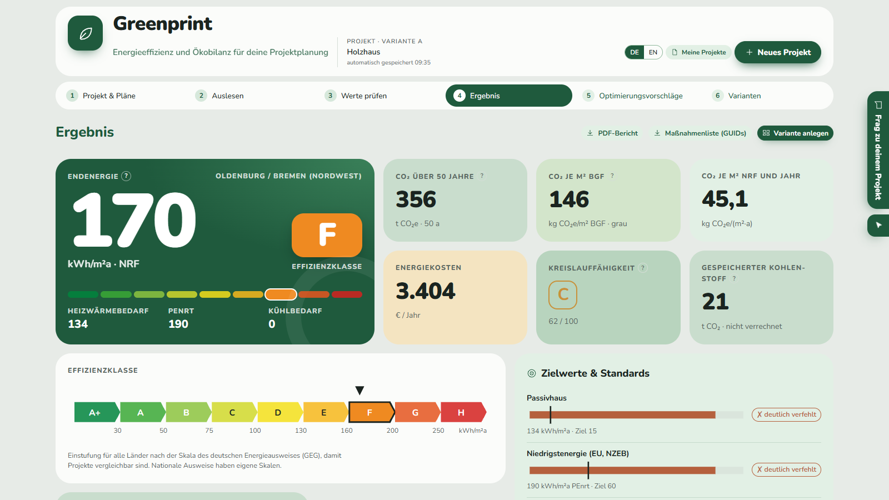
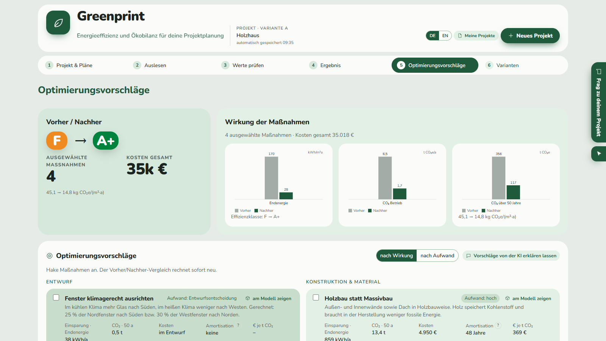

# Greenprint – Energieeffizienz und Ökobilanz für deine Projektplanung

**Greenprint wertet Pläne oder ein 3D-/BIM-Modell eines Gebäudes aus und liefert eine Energie- und Ökobilanz mit konkreten Optimierungsvorschlägen für Bauweise und Materialwahl.**

▶ **Live-Demo:** https://jade-hs-vibecoding-wpk.github.io/Energieeffizienz-Oekobilanz-Optimierung/

Die App läuft direkt im Browser, ohne Installation und ohne Konto. Für die KI-Funktionen trägt jede Person ihren eigenen, kostenlosen OpenRouter-Key ein (siehe [KI einrichten](#ki-einrichten-optional)). Entstanden im Wahlpflichtkurs *Vibecoding / KI-Anwendungen* (5. Semester Architektur, Jade Hochschule), 2026.

## Screenshots

| Startseite | Werte prüfen mit 3D-Modell |
|---|---|
|  |  |
| **Ergebnis** | **Optimierungsvorschläge** |
|  |  |

*Beispiel: Holzhaus als IFC-Modell, aufgenommen in der Live-Demo (1600 × 900 Pixel).*

---

## Was die App kann

| Bereich | Funktionen |
|---|---|
| **Eingabe** | Pläne als JPG, PNG oder PDF (Grundriss, Schnitt, Ansicht, Lageplan, Detail) **und/oder** ein 3D-/BIM-Modell (IFC, OBJ, glTF, GLB). Dazu Projektangaben und ein Standort in ganz Europa. |
| **Auslesen** | Die KI liest Pläne: Flächen, Fenster, Bauweise, Schichtaufbauten. IFC-Modelle wertet die App direkt aus: Flächen, Ausrichtung, innen/außen, Materialschichten und IFC-GUIDs. Schichtweise modellierte Wände fasst sie zu einer Außenwand zusammen. |
| **Werte prüfen** | Alle Bauteile in einer Tabelle. Beim Überfahren der Aufbau-Liste zeigt ein Infofenster Schichten, Dicken, λ-Werte und U-Wert. Dazu kommen eigene Schichtaufbauten, Fenster, Technik und Klimadaten. |
| **Ergebnis** | Effizienzklasse (A+ bis H), Energiebilanz, Ökobilanz über 50 Jahre (Module A1–A3, B4, B6, C3–C4), Kreislauffähigkeit, gespeicherter Kohlenstoff und Zielwerte (Passivhaus, NZEB, Level(s), RIBA 2030). Außerdem sommerlicher Wärmeschutz, Tageslicht, PV und Regenwasser. |
| **Optimierungsvorschläge** | Maßnahmen zum Anhaken, jeweils mit Einsparung, Kosten, Amortisation und € pro t CO₂. Dazu ein Vorher/Nachher-Vergleich und auf Wunsch KI-Erklärungen. |
| **Varianten** | Bis zu 3 Varianten nebeneinander vergleichen. |
| **3D-Ansicht** | Das Modell wird farbig nach Wärmeverlust, CO₂, Kreislauf oder Sonne eingefärbt. Bauteile lassen sich anklicken und ändern. Werkzeuge: **Sprengen** und **Schnitt** (waagerecht, längs, quer) mit Schieberegler sowie **Dachaufsicht**. |
| **Projekt-Chat** | Reiter am rechten Rand: Fragen zum eigenen Projekt an die KI, die die aktuellen Werte kennt. |
| **Meine Projekte** | Projekte werden automatisch im Browser gespeichert und lassen sich wieder öffnen, kopieren oder löschen. Ohne Konto, nur auf dem eigenen Gerät. |
| **Export** | **PDF-Bericht**: A4 mit Deckblatt, Inhaltsverzeichnis, Kapiteln und Fußzeile. Bei Modellen zusätzlich eine **Maßnahmenliste mit IFC-GUIDs** als Excel-Datei, mit der man jede Änderung im BIM-Programm wiederfindet. |
| **Sonstiges** | Deutsch/Englisch, Glossar mit Erklärungen zu jedem Fachbegriff, Intro-Animation, Fußabdruck-Mauszeiger (umschaltbar). Läuft auch auf Tablet und Handy. |

## So benutzt du die App

1. **Projekt & Pläne:** Pläne und/oder ein 3D-Modell hochladen, Gebäudetyp, Neubau oder Bestand und Standort wählen.
2. **Auslesen:** Die App bzw. die KI liest Pläne und Modell aus.
3. **Werte prüfen:** Flächen und Bauteilaufbauten kontrollieren und bei Bedarf anpassen.
4. **Ergebnis:** Kennzahlen, Diagramme und Zielwerte ansehen. Hier lässt sich auch der PDF-Bericht erstellen.
5. **Optimierungsvorschläge:** Maßnahmen anhaken und die Wirkung im Vorher/Nachher-Vergleich sehen.
6. **Varianten:** Varianten anlegen und vergleichen.

Ohne eigene Dateien kannst du die App auch mit dem eingebauten **Beispielprojekt** ausprobieren.

## KI einrichten (optional)

Für Planlesen, Erklärungen und Chat nutzt die App **kostenlose KI-Modelle über [OpenRouter](https://openrouter.ai)**. Jede Person braucht dafür ihren **eigenen** API-Key.

1. Bei OpenRouter ein kostenloses Konto anlegen und einen API-Key erstellen.
2. In der App unten in der Fußzeile auf die **KI-Statuszeile** klicken.
3. Key einfügen, auf „Verbindung testen“ und dann auf „Speichern“ klicken.

Der Key bleibt **nur in deinem Browser**. Er landet nicht in Dateien und nicht auf GitHub.

## Wichtiger Hinweis

> Greenprint ist eine **überschlägige Abschätzung für Entwurf und Lehre**. Die App ersetzt keinen Energieausweis, keine Berechnung nach DIN V 18599 und keine Ökobilanz nach EN 15978. KI-gestützte Inhalte (Planlesen, Erläuterungen, Fazit) sind ohne Gewähr und sollten fachlich geprüft werden.

**Rechenweg in Kürze:** Heizwärmebedarf nach dem vereinfachten Heizperiodenverfahren (Transmission, Lüftung, solare und interne Gewinne). Die Ökobilanz rechnet mit Materialkennwerten in Anlehnung an ÖKOBAUDAT und EPD-Durchschnittswerte über einen Betrachtungszeitraum von 50 Jahren. Klima- und Länderdaten decken ganz Europa ab. Alle Annahmen und Quellen stehen in der App unter „Annahmen & Quellen“ und am Ende des PDF-Berichts.

**Datenschutz:** Projekte werden nur im eigenen Browser gespeichert. Pläne werden nur zur Auswertung an die KI geschickt, wenn du sie dafür freigibst.

## Technik

Die App ist eine reine **Browser-App** aus HTML, CSS und JavaScript. Sie hat keinen eigenen Server und läuft über **GitHub Pages**.

```
├── index.html            Startseite (leitet zur App weiter)
├── App-lokal-starten.bat startet die App lokal (localhost:8765)
├── PLAN.md               ursprünglicher Umsetzungsplan (Anfangsidee)
├── docs/screenshots/     Screenshots der Live-Demo
└── app/
    ├── index.html        Seite, Gestaltung, Intro, Mauszeiger
    ├── main.js           Oberfläche: Schritte, Formulare, Ergebnis, Chat, Meine Projekte
    ├── calc.js           Rechenkern: Energie, Ökobilanz, Maßnahmen
    ├── data.js           Baustoffe, Bauteilkatalog, Klima- und Länderdaten, Zielwerte
    ├── i18n.js           Texte Deutsch/Englisch, Glossar
    ├── charts.js         Diagramme und Symbole
    ├── ai.js             KI-Anfragen (Plan lesen, Erklärungen, Chat)
    ├── ai-openrouter.js  KI über OpenRouter mit eigenem Key
    ├── viewer.js         3D-/BIM-Import und -Ansicht, Sprengen, Schnitt
    ├── export.js         PDF-Bericht, Maßnahmenliste
    └── web-ifc.wasm      Baustein zum Lesen von IFC-Dateien
```

**Verwendete Bibliotheken** (aus dem Internet geladen): Tailwind CSS, three.js, web-ifc, pdf.js, jsPDF, SheetJS und die Schrift Nunito.

### Lokal starten

1. Doppelklick auf **`App-lokal-starten.bat`**, oder im Ordner `app` diesen Befehl ausführen: `python -m http.server 8765`
2. Im Browser **http://localhost:8765** öffnen.

## Mitwirkende

- **Caro255**: Idee, Konzept, Gestaltung, Tests
- Umsetzung mit Unterstützung von **Claude** (Anthropic) im Rahmen des Vibecoding-Kurses

## Quellen, Lizenz und KI-Nutzung

### Daten und Rechengrundlagen
| Thema | Quelle |
|---|---|
| Baustoffkennwerte | ÖKOBAUDAT (BMWSB) und EPD-Durchschnittswerte, gerundet |
| Heiz-/Kühlgradtage | Eurostat nrg_chdd (langjähriges Mittel, gerundet) |
| Sonneneinstrahlung | PVGIS, Europäische Kommission JRC (gerundet) |
| Strom-CO₂ je Land | Europäische Umweltagentur (EEA), Stand ca. 2023, gerundet |
| Energie- und Baupreise | Eurostat (Haushaltspreise, Preisniveauindizes), gerundet |
| Effizienzklassen | GEG Anlage 10 (Endenergie), als gemeinsame Skala für alle Länder |
| Zielwerte | Passivhaus Institut (≤ 15 kWh/m²a), RIBA 2030 Climate Challenge v2 (2021), EU Level(s) Indikator 1.2 mit Bändern nach Röck et al. (2020) |
| Lebensphasen | EN 15978: A1–A3, B4, B6, C3–C4 |

Alle Werte sind für die überschlägige Abschätzung vereinfacht und gerundet.

### Bibliotheken und Schrift
| Baustein | Zweck | Lizenz |
|---|---|---|
| [Tailwind CSS](https://tailwindcss.com) | Gestaltung | MIT |
| [three.js](https://threejs.org) | 3D-Ansicht | MIT |
| [web-ifc](https://github.com/ThatOpen/engine_web-ifc) (inkl. `web-ifc.wasm`) | IFC-Dateien lesen | MPL-2.0 |
| [pdf.js](https://mozilla.github.io/pdf.js/) | PDF-Pläne in Bilder umwandeln | Apache-2.0 |
| [jsPDF](https://github.com/parallax/jsPDF) | PDF-Bericht erzeugen | MIT |
| [SheetJS](https://sheetjs.com) (Community Edition) | Maßnahmenliste als Excel | Apache-2.0 |
| [Nunito](https://fonts.google.com/specimen/Nunito) | Schrift | SIL Open Font License 1.1 |
| [Playwright](https://playwright.dev) | Screenshots (nicht Teil der App) | Apache-2.0 |

### Lizenz
Der Code dieses Projekts steht unter der [MIT-Lizenz](LICENSE) · © 2026 Vibecoding KI-Werkstatt · Jade Hochschule.

### KI-Nutzung
- **Entwicklung:** Konzept, Gestaltung und alle Entscheidungen stammen von Caro255. Den Programmcode hat **Claude** (Anthropic) über *Claude Code* nach diesen Vorgaben geschrieben, Schritt für Schritt erklärt und getestet.
- **In der App:** Planlesen, Erklärungen der Vorschläge, Fazit und Projekt-Chat nutzen KI-Modelle. Das sind kostenlose Modelle über [OpenRouter](https://openrouter.ai) (Standard: Google Gemma 4) mit dem eigenen Key der Nutzerin bzw. des Nutzers, oder die eingebaute Claude-KI, wenn die App über claude.ai geöffnet wird.
- **Die Berechnungen** (Energie, Ökobilanz, Maßnahmen) laufen ohne KI nach festen Formeln.
- KI-Inhalte sind im PDF-Bericht gekennzeichnet. Sie sind ohne Gewähr und sollten fachlich geprüft werden.
